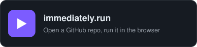
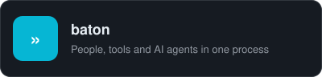
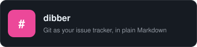
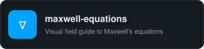
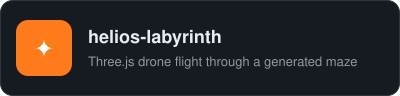
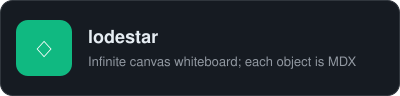
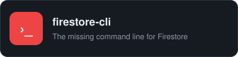

## Hey 👋, I'm Peter Neumark!

I build tools that run code in the browser 🌐. These days that means sandboxes, in-browser filesystems and bundlers, and the apps that live on top of them 🛠️.

 

### 🧐 More About Me:

- 🔭 &nbsp; I'm currently building **[immediately.run](https://immediately.run)**: open a GitHub repo and it runs in your browser, with no install and no deploy
- 🧩 &nbsp; Even its editor, file explorer and theme toggle are apps you can fork
- 🤝 &nbsp; I'd love to see what you build on it: start from the [showcase](https://github.com/immediately-run/showcase)
- 📚 &nbsp; Before that I spent a lot of time on [TiddlyWiki](https://tiddlywiki.com) and [Firebase](https://firebase.google.com) tooling
- 👨🏻‍💻 &nbsp; Most of my projects are on [GitHub](https://github.com/neumark?tab=repositories) and in the [immediately-run](https://github.com/immediately-run) org
- 💬 &nbsp; Ask me about browser sandboxes, iframes and `postMessage`, or running Node-style code client-side
- 📫 &nbsp; Find me at [peterneumark.com](http://peterneumark.com)

 

### 🔨 Languages and Tools:

 

### 🛠️ My Projects

More projects

- [firestore-export-json](https://github.com/neumark/firestore-export-json): convert Firestore/Datastore LevelDB exports to JSON
- [mini-iframe-rpc](https://github.com/neumark/mini-iframe-rpc): RPC across iframes over `postMessage`
- [replay-fsm](https://github.com/neumark/replay-fsm): replayable finite state machines in ES6
- [tw5-cljs](https://github.com/neumark/tw5-cljs): ClojureScript support for TiddlyWiki5
- [rhyme-search-hun](https://github.com/neumark/rhyme-search-hun): a rhyme finder for Hungarian

